# sw-iot-telemetry-platform

Sensor data from edge devices to a live dashboard: MQTT with certificate-bound
device identity, validated ingestion, stream processing with rollups,
TimescaleDB with a retention ladder, a rule-based alerting engine and a typed
React dashboard.

```mermaid
flowchart LR
    subgraph edge["EDGE"]
        direction TB
        SIM["Device simulator<br/><i>3 profiles, 9 fault modes</i>"]
        FW["ESP32 + BME280<br/><i>compiles, never flashed</i>"]
    end

    BROKER["<b>BROKER</b><br/>Mosquitto, mutual TLS<br/><i>AWS: IoT Core</i>"]
    INGEST["<b>INGEST</b><br/>validate, reject, explode<br/><i>AWS: IoT Core rule</i>"]
    STREAM["<b>STREAM</b><br/>Redpanda<br/><i>AWS: Kinesis</i>"]
    PROC["<b>PROCESSING</b><br/>raw writes +<br/>live rollups"]
    DB[("<b>TIMESCALEDB</b><br/>raw 30d · 1m 180d · 1h 730d")]
    API["<b>QUERY API</b><br/>REST + WebSocket"]
    ALERT["<b>ALERTING</b><br/>13 rules"]
    WEB["<b>DASHBOARD</b><br/>React + TS"]
    DLQ[("dead_letters<br/><i>8 reasons</i>")]
    BQ["<b>ANALYTICS</b><br/>Parquet → BigQuery"]

    SIM -->|"mTLS<br/>dt/{tenant}/{site}/{device}/telemetry"| BROKER
    FW -.->|"same schema"| BROKER
    BROKER --> INGEST
    INGEST -->|accepted| STREAM
    INGEST -->|"rejected,<br/>with a reason"| DLQ
    STREAM --> PROC
    PROC --> DB
    DB --> API
    DB --> ALERT
    DLQ --> DB
    ALERT -->|alerts.fired| API
    API --> WEB
    DB --> BQ

    classDef built fill:#1f6feb,stroke:#58a6ff,color:#fff
    classDef unbuilt fill:#30363d,stroke:#8b949e,color:#c9d1d9,stroke-dasharray: 4 3
    class SIM,BROKER,INGEST,STREAM,PROC,DB,API,ALERT,WEB,DLQ,BQ built
    class FW unbuilt
```



```bash
docker compose up -d --build --wait
```

Dashboard on [localhost:5173](http://localhost:5173), API docs on
[localhost:8000/docs](http://localhost:8000/docs). That one command issues a
certificate authority, a broker certificate and a certificate per device,
migrates the schema, creates the stream topics and starts a simulated fleet
publishing over mutual TLS. Nothing needs installing but Docker.

---

## What it does

| | |
| --- | --- |
| **Identity** | One X.509 client certificate per device. The broker takes the identity from the certificate and the ACL confines each device to its own topic. A payload claiming to be another device is rejected. |
| **Ingestion** | Eight rejection reasons, each stored with the offending payload. A message is never silently dropped. |
| **Storage** | Four resolutions behind one API that picks the cheapest adequate source and tells you which it used. |
| **Alerting** | 13 rules with sustained-breach holds, recovery hysteresis and deduplication in the database. |
| **Measured** | 2,494 readings/s with zero loss and 60 ms median end-to-end, reproducible from one command. |

## Numbers

All from [`bench/benchmark.py`](bench/benchmark.py) against the full stack on one
Ryzen 7 5700X. Full method and caveats in [docs/benchmarks.md](docs/benchmarks.md).

| Fleet | Offered | Stored | Loss | Publish → queryable |
| --- | --- | --- | --- | --- |
| 50 devices × 10 Hz | 499 msg/s | **2,494 readings/s** | 0.000% | p50 60 ms, p99 169 ms |
| 50 devices × 20 Hz | 972 msg/s | **4,858 readings/s** | 0.000% | p50 70 ms, p99 138 ms |
| 100 devices × 25 Hz | 2,323 msg/s | 10,825 readings/s | 6.797% | p50 8.8 s, p99 16.0 s |

The knee is between roughly 4,900 and 10,800 readings per second on this
hardware. Above it the failure mode is **growing latency, not loss**: that 6.8
per cent was still queued in Redpanda when the benchmark stopped waiting, not
thrown away. That is a direct consequence of putting a durable stream between
ingest and storage, and it is the correct way for a telemetry pipeline to fail.

```bash
make bench BENCH_DEVICES=50 BENCH_RATE=10 BENCH_DURATION=60
```

## The three decisions that shaped it

### The simulator came before the hardware, and that is why the rest works

The brief asked for it in that order, and it turned out to be the most
consequential decision in the repository.

By the time any firmware existed, the schema, the topic grammar, the identity
check, the rollups, the retention ladder, the alerting rules and the dashboard
had all been exercised against hundreds of thousands of messages. Nine fault
modes are injectable, and each one maps to a platform path that is otherwise
untestable without waiting for real hardware to misbehave:

| Fault | Proves |
| --- | --- |
| `stuck` | a flatline rule catches a dead sensor whose readings stay plausible |
| `spike` | range validation routes nonsense to the dead-letter table |
| `dropout` | the offline rule fires, and then recovers |
| `clock_skew` | ingest lag metrics separate device clocks from real lag |
| `drain` | low battery fires before the device dies |
| `bearing` | a sustained-breach rule beats a single-sample threshold |
| `schema_drift` | an unsupported major is dead-lettered, not stored |
| `spoof` | **topic identity beats payload identity** |

Building the device first would have meant debugging a schema, a broker ACL and
a stuck I2C bus simultaneously, with no way to tell which was at fault.

### Identity comes from the certificate, never from the payload

The `device_id` in the topic is authenticated by the broker from the TLS client
certificate. The `device_id` in the payload is a claim. Ingest compares them and
rejects any mismatch.

Tested adversarially against the running stack, not asserted in a comment:

- a client with no certificate cannot connect
- there is no plaintext listener at all
- a device cannot publish to another device's topic
- a spoofed payload on its own topic is dead-lettered, and stored under neither
  identity

It is the same guarantee in both deployments: Mosquitto's `%u` ACL pattern
locally, `${iot:Connection.Thing.ThingName}` policy variables on IoT Core. One
policy document covers the whole fleet, because a policy per device does not
scale and a permissive one means any compromised device can publish as any
other.

### Two rollup paths, because one table cannot be both fast and correct

| Source | Resolution | Freshness | Retention | Correct under late data |
| --- | --- | --- | --- | --- |
| `telemetry` | per sample | seconds | 30 days | yes |
| `telemetry_1m_live` | 1 minute | seconds | 2 days | **no** |
| `telemetry_1m` | 1 minute | ~1 minute | 180 days | yes |
| `telemetry_1h` | 1 hour | ~1 hour | 730 days | yes |

The dashboard cannot wait for a continuous aggregate to refresh, and a
continuous aggregate cannot refresh continuously at sane cost. So the stream
processor writes a provisional rollup within seconds and the continuous
aggregate overwrites history with the correct version later.

Choosing between them is one function,
[`services/api/api/resolution.py`](services/api/api/resolution.py), and every
response says which source answered and why:

```console
$ curl -s 'localhost:8000/api/v1/telemetry?device_id=esp32-000001&metric=temperature_c&minutes=60' | jq '{source, resolution, reason, count}'
{
  "source": "telemetry",
  "resolution": "raw",
  "reason": "window spans 60 minutes, raw samples fit",
  "count": 358
}
```

## Four things that were wrong, and how they were found

Worth recording, because each was caught by something in this repository rather
than by inspection.

**The vibration trend rule fired on healthy machines, three times over.** It
took the slope of the mean vibration over a window. The machines are duty
cycled, so the mean swings between 0.012 g idle and 0.32 g running every few
minutes, and the rule fired on every motor start. Switching to the per-bucket
minimum was also wrong, because a bucket in which the motor ran all minute has
its minimum at the running level. Comparing `min(min_value)` between the two
**halves** of the window was closer, and still fired, because a 22 minute half
against a 40 minute duty cycle can sit entirely inside a running stretch. What
works is a 90 minute window, so each half spans more than a full cycle, plus a
guard that refuses to believe a half's floor unless that half was observed both
idle and running. All three directions are now tested.
[Full account.](docs/alert_catalogue.md#vibration-trend-tracks-the-idle-floor-not-the-average)

**The threshold rule fired or did not depending on clock alignment.** A
two-minute hold filtered as `bucket > now() - 120s` spans exactly 120 seconds,
which contains one or two one-minute buckets depending on where the clock sits.
Now it ranks buckets by recency and takes the newest N, which is stable. Caught
by an integration test that injected a sustained breach and got no alert.

**The benchmark reported loss that had never happened.** Bounding published and
stored counts by timestamp let a message stamped either side of the window edge
be counted on one side and not the other. It read 0.266 per cent. Counting by
sequence range instead removed the clock from the accounting entirely, and the
figure went to 0.000 per cent and stayed there.

A fourth, found while writing this: the broker started refusing every connection
with `certificate verify failed` while every certificate was still valid for ten
months. The CRL had passed its next-update date. An expired revocation list is a
fleet-wide outage, which is [documented](docs/provisioning.md#revocation) and
was then demonstrated by accident.

## Layout

```
edge/
  firmware/            ESP32 + BME280, compiles for two targets, never flashed
  simulator/           the fleet that actually runs: 3 profiles, 9 fault modes
services/
  common/              the message contract. Schemas are generated from it.
  ingest/              MQTT to stream, validation, dead-lettering
  processing/          stream to TimescaleDB, live rollups, device registry
  api/                 query API, source selection, WebSocket feed
  alerting/            rule engine, 6 rule kinds, notification channels
web/                   React + TypeScript dashboard
db/migrations/         TimescaleDB schema: hypertables, aggregates, policies
analytics/             BigQuery queries, DuckDB-tested, and the exporter
infra/
  terraform/aws        VPC, IoT Core, Kinesis, Firehose, S3, ECR, EKS
  terraform/gcp        BigQuery dataset, tables, loader identity
  k8s/                 manifests and a dev overlay
bench/                 the benchmark every quoted number comes from
tests/                 224 unit, 25 integration
docs/                  architecture, schema, provisioning, alerts, cost, limits
```

## Documentation

| | |
| --- | --- |
| [architecture.md](docs/architecture.md) | the decisions and what was traded for what |
| [message_schema.md](docs/message_schema.md) | the contract, the versioning policy, every rejection reason |
| [provisioning.md](docs/provisioning.md) | issuing, rotating with overlap, revoking |
| [alert_catalogue.md](docs/alert_catalogue.md) | all 13 rules and why the odd ones are odd |
| [benchmarks.md](docs/benchmarks.md) | method, results, and what they do not cover |
| [cost_model.md](docs/cost_model.md) | ~$440/month at 500 devices, plus tear-down |
| [limitations.md](docs/limitations.md) | what has not been done |

## Running it

```bash
make demo              # the whole stack, waits until it is serving
make logs              # follow everything
make down              # stop, keep the data
make teardown          # stop, delete volumes, certificates and exports
```

```bash
make venv              # local virtualenv, everything editable
make check             # everything CI checks: lint, types, tests, SQL, infra
make test              # 224 unit tests, no Docker needed
make test-integration  # 25 tests against the running stack
make bench             # throughput and latency
make sample            # one message per device, no broker needed
```

`make help` lists the rest.

### Certificate lifecycle

```bash
bash scripts/pki.sh fleet 50              # issue certificates for 50 devices
bash scripts/pki.sh rotate esp32-000001   # replace, keeping the old one valid
bash scripts/pki.sh revoke esp32-000001 --previous   # and regenerate the CRL
bash scripts/pki.sh verify esp32-000001
```

### Analytical layer

```bash
make export     # TimescaleDB rollups to Parquet
make analytics  # run all five queries against it
```

The queries target BigQuery and are written once against a small macro
vocabulary so they also run on DuckDB. CI executes every one of them against
generated fixtures, because testing them against BigQuery would need a project
and a billing account, which in practice means the queries in the repository
would be the ones nobody had ever run.

## Verified, and not

| | |
| --- | --- |
| Simulator, broker with mTLS, PKI lifecycle, ingest, stream, processing, TimescaleDB, API, alerting, dashboard, benchmark, analytics | **run, and tested** |
| Terraform, both roots | `fmt` and `validate` only, **never applied** |
| Kubernetes manifests | `kustomize build` only, **never applied** |
| ESP32 firmware | compiles for two targets, **never flashed** |

There is no hardware and no AWS account behind this repository. The platform runs
and is tested; the infrastructure and the firmware are written and validated but
have not been deployed. [docs/limitations.md](docs/limitations.md) is blunter,
and lists the security work that has not been done as well.

## Licence

MIT. See [LICENSE](LICENSE).
